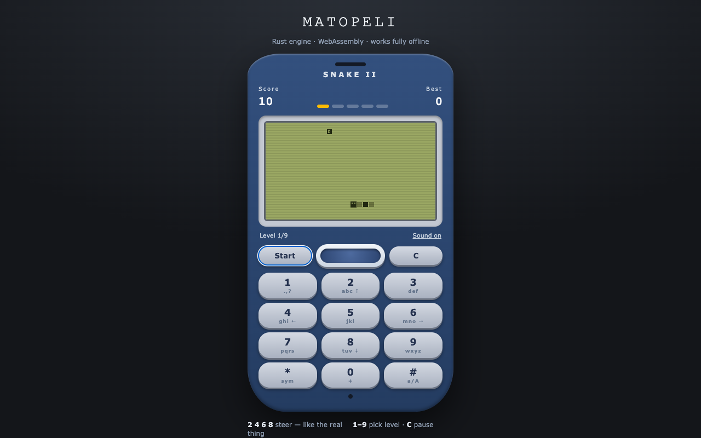
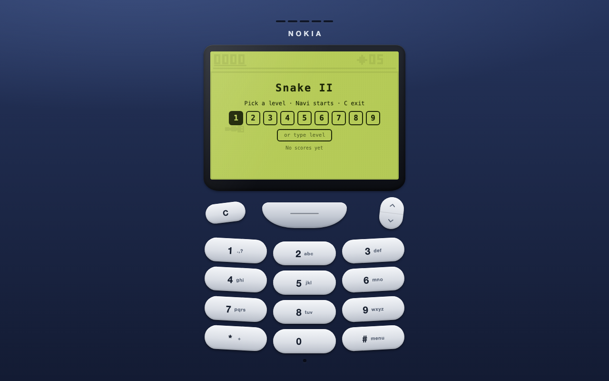
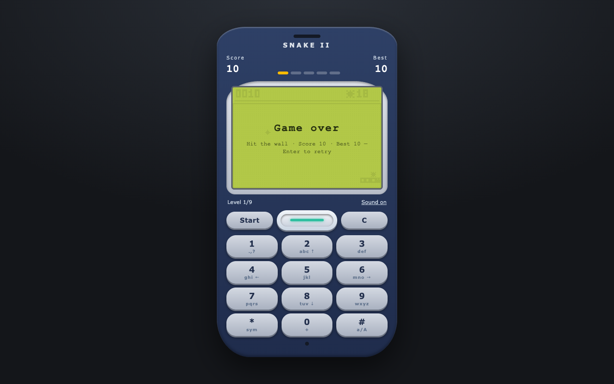
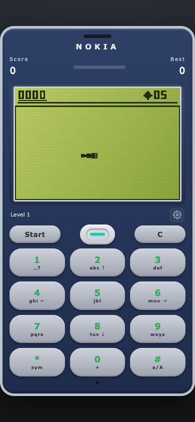

# Matopeli — Snake II in Rust + WebAssembly

[](LICENSE)
[](engine/)
[](public/engine.wasm)
[](#offline-support)

Nokia 3310 tribute. The whole game runs on a 26&nbsp;KB dependency-free
WASM module — no CDN, no fonts, no images, no backend.



| Start screen | Game over | Mobile — game first |
|---|---|---|
|  |  |  |

## How to play

| Keys | Does what |
|---|---|
| <kbd>2</kbd> <kbd>4</kbd> <kbd>6</kbd> <kbd>8</kbd> | Steer — like the real Nokia |
| <kbd>1</kbd>–<kbd>9</kbd> | Pick start level (or type any level) |
| <kbd>Start</kbd> / Navi / <kbd>Enter</kbd> | Start · resume pause · continue level · restart |
| <kbd>C</kbd> / <kbd>Space</kbd> / <kbd>Esc</kbd> | Pause / resume |
| Arrows / WASD / swipe | Also steer |

Eat **5** foods to clear each maze. Mazes cycle through **9** layouts
while levels keep rising endlessly and speed climbs to a brutal floor —
the next level starts by itself after a short breather. The edges are
portals: the snake wraps around instead of dying (only maze walls and
your own tail kill). The bonus bug spans **2×2** cells and pays
**20 + time left** but vanishes fast, and a digestion bump ripples down
the body after every bite. Fill the whole board and you clear it
outright. The top **3** scores stay in the browser and the start screen
lets you type any level. Tapping the screen follows the same rules as
the keys — pause screen resumes, level screen continues, never
restarts by accident.

## Run it

Requires Node.js ≥ 22.12 and a Rust toolchain (pinned per
`rust-toolchain.toml`).

```sh
npm install
npm run dev                 # dev server with test seam (see below)
npm run build               # production build + offline precache manifest
npm run preview             # serve production locally
```

## How it works

```text
engine/src/lib.rs  →  Rust game logic (grid, mazes, bonus, scoring)
        │  cargo build --target wasm32-unknown-unknown (26 KB, zero deps)
        ▼
public/engine.wasm →  loaded by src/scripts/snake.ts (render + input + beeps)
        │
        ▼
src/pages/index.astro + Tailwind 4  →  the 3310 around it (Astro 6)
```

TypeScript talks to the engine through plain integer exports —
no bindings generator, no glue library:

| Call | Meaning |
|---|---|
| `snake_tick()` | `0` nothing · `1` ate · `2` bonus · `3` died · `4` level up · `5` board cleared |
| `snake_state()` | `0` ready · `1` running · `2` paused · `3` over · `4` won |
| `snake_cause()` | `0` none · `1` wall · `2` self |

UI flow is one explicit banner state (`start` / `pause` / `level` /
`over`): Start resumes a pause, continues a cleared level with the
score kept, and only resets after game over or a cleared board.

## Tests

```sh
cargo test --manifest-path engine/Cargo.toml   # 19 Rust unit tests
npx tsc --noEmit                               # types
npx astro check                                # Astro + template checks
npm run build                                  # production build
BASE=http://localhost:4321 npm run test:e2e    # prod smoke (banners, restart, level input, high score, console)
BASE=http://localhost:4322 npm run test:state  # dev state machine (eat, pause, level-up, touch)
BASE=http://localhost:8901 npm run test:offline # offline reload + play
```

`test:state` drives the real game in a dev browser through a
read-only `window.__matopeli` seam that exists only in dev builds —
it is compiled out of production. It steers toward actual food,
pauses mid-game, clears a level, and proves score and level survive
every transition.

## Regenerate the WASM artifact

```sh
cd engine
cargo build --release --target wasm32-unknown-unknown
cp target/wasm32-unknown-unknown/release/engine.wasm ../public/engine.wasm
```

The release build is byte-deterministic for the pinned toolchain, so
CI compares the committed `public/engine.wasm` against a fresh build
and fails on drift. Never edit the binary by hand.

## Offline support

`npm run build` also runs `scripts/gen-sw.mjs`, which writes
`dist/sw.js` with the exact hashed assets of that build. The worker
precaches the page, the bundle, the CSS and the WASM; navigation is
network-first with a cached fallback, versioned assets are cache-first,
only successful same-origin responses are stored, and only
`matopeli-*` caches are ever deleted. Validate with
`npm run test:offline`, which loads online, waits for precaching,
cuts the network, reloads, and starts a game.

## Limitations

- Full 9-level browser playthroughs are not automated (luck-based);
  level transitions are covered by engine tests plus a scripted
  level-1 → level-2 browser run.
- Back/forward-cache restore recreates a fresh game instead of the
  exact mid-run state (no use-after-free: the old instance is
  destroyed on hide).
- Sounds need a user gesture first (browser policy); vibration is
  mobile-only and guarded.

## License

MIT — see [LICENSE](LICENSE).
